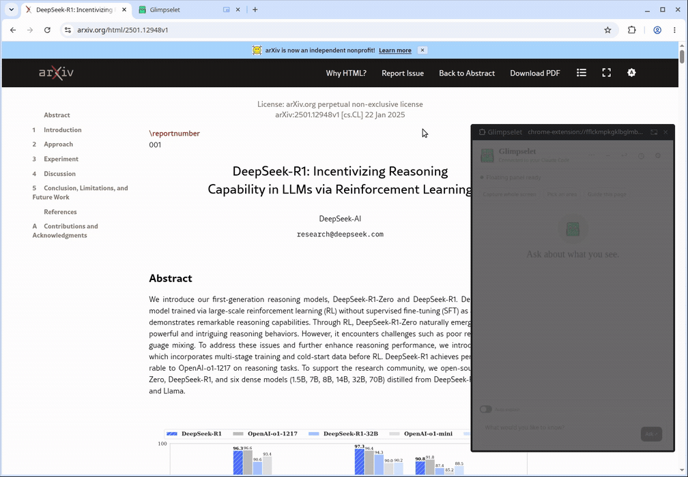

<h1 align="center"><br /><picture><source media="(prefers-color-scheme: dark)" srcset="assets/wordmark-dark.svg" /></picture></h1>

<p align="center"><strong>La réponse reste à côté de la page.</strong></p>

<p align="center">
  <a href="https://github.com/Arthur031221/Glimpselet/actions/workflows/ci.yml"></a>
  <a href="https://github.com/Arthur031221/Glimpselet/releases"></a>
  <a href="LICENSE"></a>
</p>

[English](README.md) | [繁體中文](README.zh-TW.md) | [简体中文](README.zh-CN.md) | [日本語](README.ja.md) | [한국어](README.ko.md) | [Español](README.es.md) | [Français](README.fr.md) | [Deutsch](README.de.md) | [Português](README.pt-BR.md)

Formerly Glimpselet. Vous utilisez l'ancien plugin ? Exécutez `/plugin uninstall glimpselet@glimpselet` puis `/plugin marketplace remove glimpselet`, et installez Blinkling avec les étapes ci-dessous.

Un petit chat flottant Claude Code. Posez une question sur la page, capturez une zone, suivez un guide ou traduisez un passage.

> [!TIP]
> Utilisez votre propre compte Claude Code connecté et Chrome ou Edge sur ordinateur. Claude Code ne nécessite pas de clé API.


_Google Flights : un guide de la page, puis une question sur la réservation d'un aller-retour._

## Installation

1. Installez le plugin dans Claude Code :

   ```text
   /plugin marketplace add Arthur031221/Glimpselet
   /plugin install blinkling@blinkling
   ```

2. Ouvrez le guide de bienvenue :

   ```text
   /blinkling:blinkling
   ```

3. Activez le **mode développeur** dans `chrome://extensions` (ou `edge://extensions`). Choisissez **Load unpacked** et le dossier ouvert par **Show in Files / Finder**. La page de bienvenue se connecte automatiquement. Ouvrez la bulle.

> [!NOTE]
> Sur un ordinateur local, **Try without installing** ouvre un profil Chromium séparé. Pour un hôte distant, exécutez la commande SSH affichée sur l'ordinateur du navigateur. [Installation et mises à jour](docs/INSTALL.md).

### Avancé : charger depuis les sources

<details>
<summary>Code source et mises à jour manuelles</summary>

Pour lancer le plugin depuis les sources, il vous faut Node.js 22+ et une version récente de Claude Code. Si votre terminal se trouve déjà à la racine d'une copie locale du dépôt, sautez les deux premières commandes. Exécutez ces commandes dans le terminal :

```sh
git clone https://github.com/Arthur031221/Glimpselet.git
cd Blinkling
npm ci
npm run build:plugin
claude plugin validate .
node -p "require('./.claude-plugin/plugin.json').version"
node -p "require('./dist-extension/manifest.json').version"
claude --plugin-dir "$PWD" plugin list
claude --plugin-dir "$PWD" plugin details blinkling
node -p "require('./bin/extension/manifest.json').version"
claude --plugin-dir "$PWD"
```

Les deux vérifications de version doivent afficher `2.1.0`. La liste des plugins doit afficher `blinkling@inline` en version `2.1.0`, activé pour cette session. La dernière commande ouvre Claude Code. Exécutez-y `/blinkling:blinkling` pour ouvrir le guide de bienvenue. `--plugin-dir` charge cette copie du dépôt uniquement pour cette session. Utilisez cette option à chaque lancement et redémarrez Claude Code après avoir relancé `npm run build:plugin`. L'extension compilée se trouve dans `dist-extension`. Le guide de bienvenue la copie dans le dossier stable indiqué ci-dessous.

Les détails du plugin doivent aussi inclure les compétences `blinkling` et `install` et le serveur MCP `blinkling`. L'extension empaquetée se trouve dans `bin/extension`. Sa version doit aussi être **2.1.0**. Si Claude Code est distant, utilisez la commande SSH du guide, téléchargez le ZIP de l'extension sur l'ordinateur avec le navigateur et chargez-y le dossier extrait.

Si le navigateur et Claude Code fonctionnent sur le même ordinateur, le guide de bienvenue copie l'extension compilée dans le dossier stable `~/Blinkling-extension`. Dans Chrome ou Edge, ouvrez `chrome://extensions` ou `edge://extensions`, activez **Developer mode**, choisissez **Load unpacked** et sélectionnez ce dossier. La bannière de développement reste visible. Les mises à jour doivent être installées manuellement.
Pour mettre à jour une extension décompressée, fermez l'ancienne bulle et relancez `/blinkling:blinkling` pour actualiser le dossier stable. Cliquez sur Recharger sur la fiche de l'extension. Si Claude Code est distant, téléchargez le nouveau ZIP depuis le guide, remplacez les fichiers extraits sur la machine avec le navigateur, puis rechargez l'extension. Pour passer à `~/Blinkling-extension`, supprimez l'ancienne fiche et chargez ce dossier une fois.

Pour mettre à jour le plugin installé, exécutez ces commandes, puis `/reload-plugins` et `/blinkling:blinkling` dans Claude Code. Vérifiez **2.1.0** dans la liste des plugins et sur la fiche de l'extension avant de rouvrir la bulle.

```sh
claude plugin marketplace update blinkling
claude plugin update blinkling@blinkling
claude plugin list
```

</details>

## Pendant la lecture

- **Capturer l'écran** ou **Choisir une zone**. Maintenez Shift et faites glisser sur une page compatible ou dans la bulle. Entrée confirme, Échap annule. La bulle disparaît pendant la capture partagée, puis revient.
- **Guider cette page** propose une vue générale et un parcours Suivant/Précédent des zones de lecture et des commandes.
- Sélectionnez du texte pour poser une question, expliquer ou traduire. Traduisez une page puis restaurez-la, ou ouvrez un PDF dans le lecteur intégré.
- **Explication automatique** propose jusqu'à trois questions et résume les changements. Alt+P met en pause. Choisissez Opus, Sonnet ou Haiku pour le chat.



_arXiv : sélectionner un résumé, poser une question et le traduire en chinois traditionnel._

Enregistré avec la vraie extension sur des sites en ligne et des réponses de Claude Code. Les attentes sont raccourcies. Le contenu et les réponses ne sont pas préparés.

## Raccourcis

| Raccourci    | Action                                |
| ------------ | ------------------------------------- |
| Alt+Shift+G  | Ouvrir la bulle                       |
| Ctrl+Shift+S | Recadrer dans le navigateur           |
| Ctrl+Shift+7 | Recadrer depuis une autre application |

Sur macOS, utilisez Cmd au lieu de Ctrl. Modifiez les raccourcis dans `chrome://extensions/shortcuts`. Shift fonctionne uniquement sur les pages compatibles et dans la bulle.

## Sessions et confidentialité

Blinkling utilise un canal actif vérifié de Claude Code. Sinon, un processus séparé reprend la dernière conversation enregistrée du projet. Évitez de travailler simultanément sur ce même historique dans le terminal. [Canal et limites](docs/DESIGN.md#the-running-claude-code-conversation).

> [!IMPORTANT]
> Explication automatique résume les changements **sans partage d'écran**, après consentement et autorisation du site. Les champs de mot de passe et la liste de blocage suspendent résumés et suggestions automatiques. Les résumés d'écran utilisent un onglet partagé associé au même onglet inspecté, avec les mêmes vérifications. Un écran ou une application partagés nécessitent **un consentement séparé pour chaque partage**. Les pixels ne permettent pas de vérifier mots de passe ou sites bloqués. Les sources inconnues restent en pause.
> Les pages intégrées en chargement ou inaccessibles suspendent aussi les requêtes automatiques.

Aucune télémétrie ni service de réponses géré par l'éditeur. Le contexte et les captures choisis vont à votre backend. Ses conditions et coûts s'appliquent. Les applications natives fournissent seulement des pixels. Les paramètres, boutiques d'extensions et pages protégées bloquent les outils. Opacité et passage des clics de la fenêtre native dépendent du navigateur. [Confidentialité](docs/SECURITY.md) | [Utilisation](docs/USAGE.md) | [Notes de version](docs/releases/v2.1.0.md)

Assisted by Claude/Codex.
