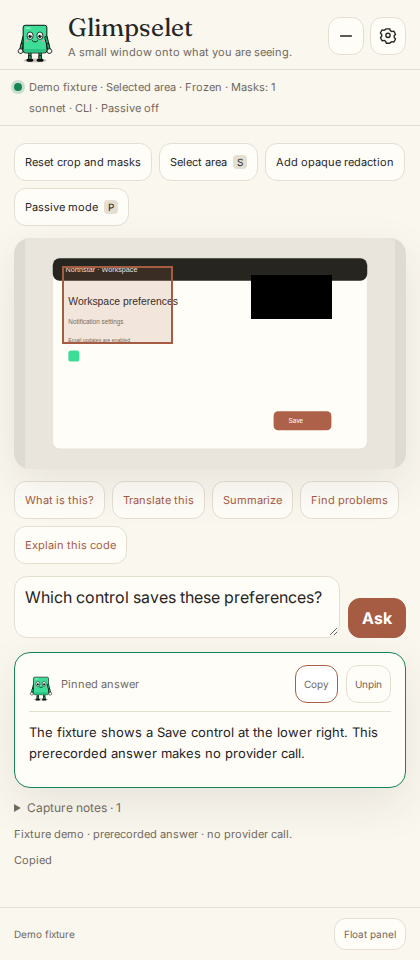
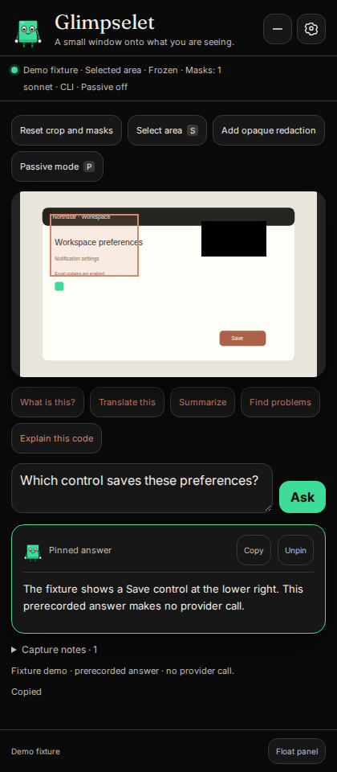
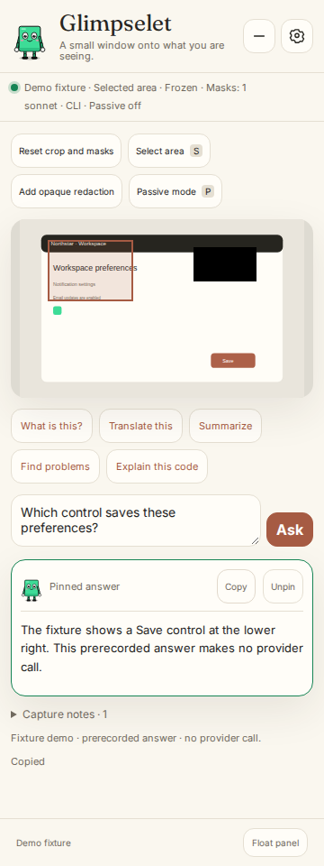
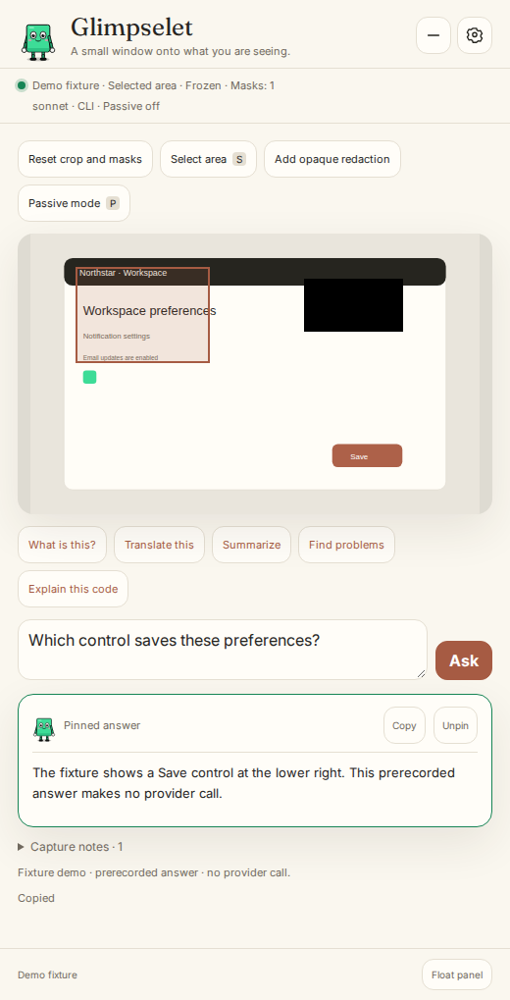
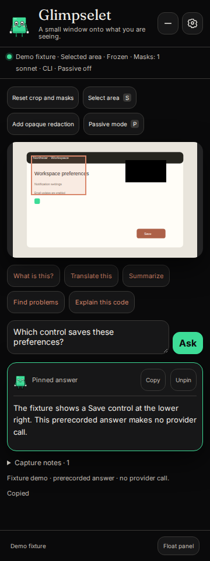
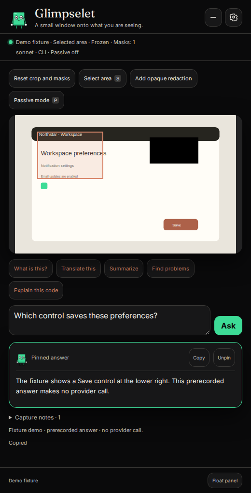

<p align="center"><br><strong>Glimpselet</strong><br><em>Blink waits. You point. It answers.</em></p>

<p align="center"><a href="README.zh-TW.md">Traditional Chinese</a>  |  <a href="README.zh-CN.md">Simplified Chinese</a>  |  <a href="README.ja.md">Japanese</a>  |  <a href="README.ko.md">Korean</a>  |  <a href="README.es.md">Spanish</a>  |  <a href="README.fr.md">French</a>  |  <a href="README.de.md">German</a>  |  <a href="README.pt-BR.md">Brazilian Portuguese</a></p>

> Pick a screen and ask your coding assistant about it in a compact floating panel. Freeze a frame, crop it, cover private details, then ask.

<p align="center"></p>

<p align="center"><a href="https://arthur031221.github.io/Glimpselet/">Open the static demo</a>. It uses a fixture image and prerecorded answer. There are no provider calls.</p>

<p align="center"></p>

<details>
<summary>All six panel sizes and themes</summary>

<p></p>
<p></p>

</details>

Floating mode needs a desktop Chromium browser. Install Node.js 22 or newer and a coding assistant first.

On macOS or Linux, install from a terminal:

```sh
curl -fsSL https://raw.githubusercontent.com/Arthur031221/Glimpselet/main/install.sh | sh
```

Then open `/glimpselet:glimpse`. You'll need Node.js 22 or newer and the installed coding assistant.

## A normal look

```text
/glimpselet:glimpse
Choose a screen, window, or tab in the browser picker.
Freeze a frame, crop it, and add opaque masks over private details.
Ask what you want to know, read the streamed answer and follow up.
Copy or pin the answer, then clear the session when finished.
```

The panel sends a frame to the provider when you ask or enable passive notes. MCP screen tools return images to the coding session when called. Opaque masks change the outgoing image. Passive notes sample every two seconds and send changed frames for short descriptions. They're capped at six requests per rolling minute (up to 360 per hour). You can lower the cap. The cap limits requests. It doesn't estimate dollar cost.

Panel captures are capped at 1536 pixels on the longest edge and 1.8 million pixels after cropping and redaction. Smaller selected areas keep their original resolution.

**The screen is yours to share. Nothing starts watching on its own.**

## Details

<details>
<summary>Install from an interactive coding session</summary>

Install the same bundled plugin from your coding assistant with these slash commands:

```text
/plugin marketplace add Arthur031221/Glimpselet
/plugin install glimpselet@glimpselet
```

Both commands work on macOS, Windows and Linux with the installed coding assistant and Node.js 22 or newer. Browser sharing uses the browser picker. Native capture also needs OS permission and, on Linux, the tools listed in [installation](docs/INSTALL.md). Run `/glimpselet:glimpse` to open a local panel on a random port. The link works once, within 60 seconds. The panel session stays in memory for 30 minutes. Choose a display, app window, or tab in the browser picker.

</details>

<details>
<summary>macOS</summary>

Use the terminal command above, then run `/glimpselet:glimpse` in your coding session. Browser sharing uses its permission picker. Native capture also needs screen recording permission in System Settings.

</details>

<details>
<summary>Windows</summary>

With Node.js 22 or newer and the coding assistant on PATH, run this in PowerShell:

```powershell
irm https://raw.githubusercontent.com/Arthur031221/Glimpselet/main/install.ps1 | iex
```

Then run `/glimpselet:glimpse` in your coding session.

</details>

<details>
<summary>Linux</summary>

Use the terminal command above. Browser sharing works without native screenshot utilities. For optional native capture, use `grim` and `slurp` on Wayland, or `maim` or `scrot` on X11. See [installation](docs/INSTALL.md).

</details>

<details>
<summary>Ask, follow up, and review</summary>

Questions go through the installed coding assistant or an optional API request from the local bridge. Follow-ups can use limited recent context. You'll need to trust the installed CLI and any policy hooks your organization has configured. The panel has crop, freeze, opaque masks, copy, pin, a ten-minute notes timeline, summary and Markdown export. Clear aborts active jobs and removes local frames, notes, history and the in-memory API key.

</details>

<details>
<summary>Floating window and browser support</summary>

Floating mode needs a desktop Chromium browser and a user gesture. The browser controls where Document Picture-in-Picture opens. When storage is available, a local geometry-only file and browser cache retain compact and expanded dimensions, popup position and window chrome across bridge restarts. See [configuration](docs/CONFIGURATION.md) for file locations. A popup may not stay above other windows. Capture permissions and available pickers vary by browser and operating system.

</details>

<details>
<summary>Panel controls and status</summary>

Resize the panel with its resize control or arrow keys. Drag a floating window's edges where the browser allows it. In crop or redaction mode, arrows move the selection. Shift plus arrows resize it. Enter applies it, and Escape cancels it. Escape in the question field pauses passive notes and cancels the current question while keeping its text. Settings opens in a modal. Unpin an older answer from its answer controls. **Last sent frame** labels the still image sent with a question. **Show live preview** returns to the shared screen without sending another question and keeps the crop and masks. **Pause passive notes** cancels the streaming passive job and stops future notes until resumed. S/E/T/P shortcuts work only while the screen preview is focused. You can still use the buttons with the keyboard. Scroll up to stop following a streamed answer. The panel shows sharing, model, and passive note status.

Comparison answers keep their table headers and columns. Wide tables scroll inside the answer. Focus the answer and use the arrow keys to read across it.

</details>

<details>
<summary>Develop from source</summary>

Use Node.js 22 or newer, then run `npm ci`, `npm run build`, and `npm run build:plugin`. See [contributing](CONTRIBUTING.md) for all checks. The static demo uses a fixture image and prerecorded text. It never requests a provider answer.

</details>

## Limits

During an active browser share, MCP capture uses the shared surface and fails closed if it disconnects or can't answer. It never substitutes an unmasked native capture. Disconnected sharing intent lasts until you stop sharing, clear local data or the session expires. Native fallback is available only after that intent ends. It depends on platform tools and OS permissions. macOS supports screen, window and region. Windows supports screen. Linux support depends on Wayland or X11 tools. A popup may not stay on top. The app can't reliably identify passwords, cursor positions or window titles. Review every frame before sending it.

The separate `screen_watch_start` MCP tool samples native or explicitly shared capture at a chosen 5 to 60 second interval. It keeps only changed frames and makes no model calls. Panel passive notes run separately. They sample every two seconds and request short descriptions from the selected backend.

More detail: [usage](docs/USAGE.md), [installation](docs/INSTALL.md), [configuration](docs/CONFIGURATION.md), [architecture](docs/ARCHITECTURE.md), [security](docs/SECURITY.md), [plugin layout](docs/PLUGIN.md), [contributing](CONTRIBUTING.md), [MIT license](LICENSE).

## Disclosure

Assisted by Claude/Codex.
