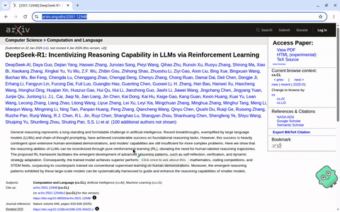
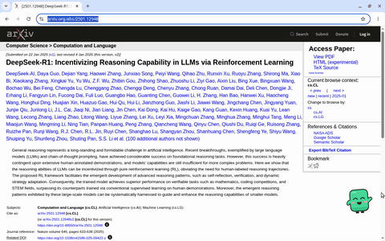

<h1 align="center"><br /><picture><source media="(prefers-color-scheme: dark)" srcset="assets/brand/wordmark-dark.svg" /></picture></h1>

<p align="center"><strong>Blink lives in the corner of your screen. Hold Ctrl, click anything, get the answer.</strong></p>

<p align="center">
  <a href="https://github.com/Arthur031221/Blinkling/actions/workflows/ci.yml"></a>
  <a href="https://github.com/Arthur031221/Blinkling/releases"></a>
  <a href="LICENSE"></a>
</p>

[English](README.md) | [繁體中文](README.zh-TW.md) | [简体中文](README.zh-CN.md) | [日本語](README.ja.md) | [한국어](README.ko.md) | [Español](README.es.md) | [Français](README.fr.md) | [Deutsch](README.de.md) | [Português](README.pt-BR.md)

Formerly Glimpselet. Coming from the old plugin? Run `/plugin uninstall glimpselet@glimpselet` and `/plugin marketplace remove glimpselet`, then install Blinkling below.

Blinkling puts Blink, a small green companion, in the corner of your screen, above every app. Hold **Ctrl** (Control on macOS) and click anything you want to ask about, or drag to take an area. It flies into Blink, you ask, and the answer opens in a chat card beside Blink.

> **Safe by design:** Blinkling only looks and explains. It never clicks, types or controls your apps.

Uses the Claude Code you are already signed in to on this computer.



## Install

You need Claude Code, signed in. Then:

1. Paste this line into a terminal and press Enter:

   ```sh
   claude plugin marketplace add Arthur031221/Blinkling && claude plugin install blinkling@blinkling
   ```

2. In Claude Code, run:

   ```text
   /blinkling:blinkling
   ```

3. On a Mac, allow **Screen Recording** for Blinkling once: System Settings, Privacy & Security. macOS also asks for **Accessibility** once, so the Ctrl key can start a pick. Allow it in the same place.

> [!NOTE]
> In Windows PowerShell 5, use `;` instead of `&&`. Animated steps for your computer: [install guide](https://arthur031221.github.io/Blinkling/install/). Other ways to install, updates and the Linux sandbox: [docs/INSTALL.md](docs/INSTALL.md).

## While you read

- **Hold Ctrl and click** a paragraph, button or picture. Blink takes it.
- **Hold Ctrl and drag** to take an area instead.
- A small composer opens with three quick asks. Enter sends the highlighted one.
- Click Blink any time to talk. The chat card opens next to Blink with your conversation.



- Blink's menu has capture, guide, auto explain (off until you turn it on) and settings.
- The optional browser helper for Chrome or Edge adds the page's own structure, so Blink knows which paragraph or button you pointed at, plus full-length page capture, translating the page in place and a reader for PDFs. Its toolbar button shows whether it is connected and wakes Blink. Without it Blink still works on every window.

## Shortcuts

| Shortcut           | Action                              |
| ------------------ | ----------------------------------- |
| Ctrl + click       | Ask about what is under the pointer |
| Ctrl + drag        | Take an area                        |
| Hotkey in Settings | Open the capture overlay            |

Pick the keys in Settings.

## Sessions and privacy

Blink sends what you picked to your own signed-in Claude Code and shows the answer in the chat card beside Blink. The terminal session that started Blink and Blink's chat follow each other, so a prompt and a finished answer typed in either place appear in both.

> [!IMPORTANT]
> The browser helper reads a page only when you point at it. Password and payment fields are never read, and it talks only to Blinkling on your own computer. Auto explain is off until you turn it on.

No telemetry or publisher-operated answer service. What you pick goes to your Claude Code. Provider terms and usage charges apply. Browser settings, extension stores and the browser's own PDF viewer are protected pages: Blink answers from the screen there. [Privacy](docs/SECURITY.md) | [Usage](docs/USAGE.md) | [Release notes](docs/releases/v3.2.0.md)

Assisted by Claude/Codex.
