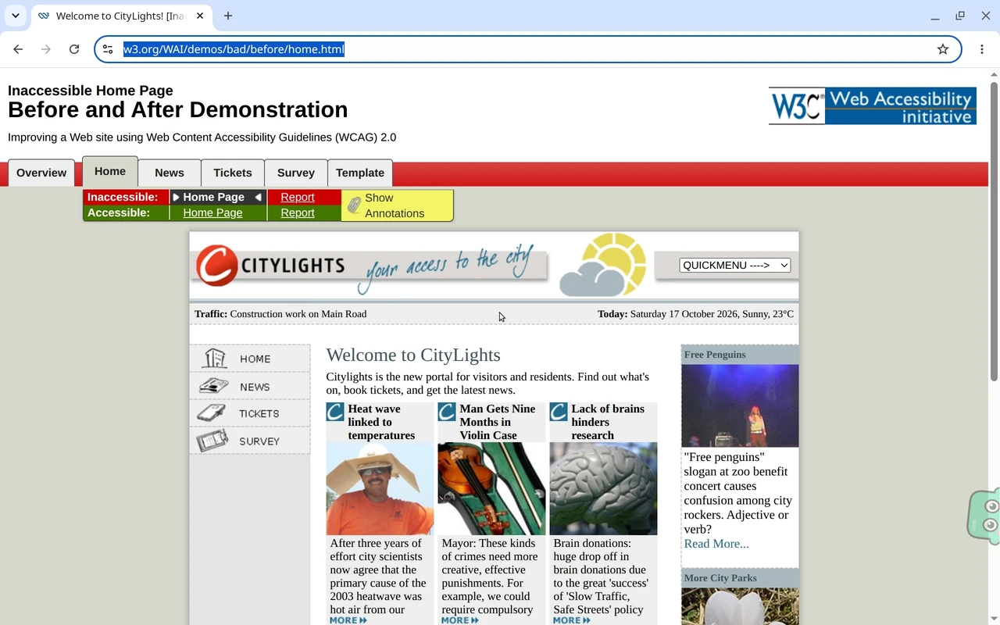
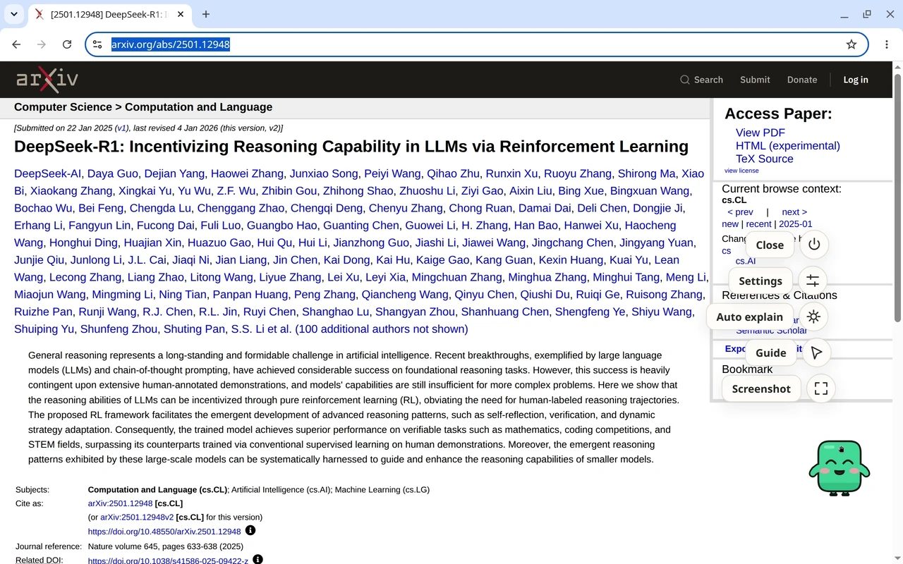

<h1 align="center"><br /><picture><source media="(prefers-color-scheme: dark)" srcset="assets/brand/wordmark-dark.svg" /></picture></h1>

<p align="center"><strong>O Blink mora no canto da sua tela. Segure Ctrl, clique em qualquer coisa e receba a resposta.</strong></p>

<p align="center">
  <a href="https://github.com/Arthur031221/Blinkling/actions/workflows/ci.yml"></a>
  <a href="https://github.com/Arthur031221/Blinkling/releases"></a>
  <a href="LICENSE"></a>
</p>

[English](README.md) | [繁體中文](README.zh-TW.md) | [简体中文](README.zh-CN.md) | [日本語](README.ja.md) | [한국어](README.ko.md) | [Español](README.es.md) | [Français](README.fr.md) | [Deutsch](README.de.md) | [Português](README.pt-BR.md)

Formerly Glimpselet. Vindo do plugin antigo? Execute `/plugin uninstall glimpselet@glimpselet` e `/plugin marketplace remove glimpselet` e depois instale o Blinkling pelos passos abaixo.

O Blinkling coloca o Blink, um pequeno companheiro verde, no canto da sua tela, acima de todos os apps. Segure **Ctrl** (Control no macOS) e clique no que quiser perguntar, ou arraste para pegar uma área. Ele voa para o Blink, você pergunta, e a resposta abre em um cartão de chat ao lado do Blink.

> **Seguro por design:** O Blinkling só olha e explica. Nunca clica, digita nem controla seus apps.

Usa o Claude Code em que você já está conectado neste computador.

<p align="center">
<br>
Artigo: Ctrl e clique em um parágrafo, e leia a resposta.
</p>

<p align="center">
<br>
Traduzir: um trecho em árabe, explicado em inglês.
</p>

<p align="center">
<br>
Guia: uma página difícil, passo a passo.
</p>

## Instalação

Você precisa do Claude Code com a sessão iniciada. No Windows, você também precisa do Node.js 22 ou mais recente de nodejs.org, instalado antes do passo 1. macOS e Linux não precisam de mais nada. Depois:

1. Cole esta linha em um terminal e pressione Enter:

   ```sh
   claude plugin marketplace add Arthur031221/Blinkling && claude plugin install blinkling@blinkling
   ```

2. Em um terminal, inicie o Claude Code com o canal do Blink:

   ```text
   claude --dangerously-load-development-channels plugin:blinkling@blinkling
   ```

   A opção faz o chat do Blink chegar a esta sessão. O Claude Code pede uma confirmação, uma só vez. Sem ela, o Blink continua funcionando e responde pela própria sessão.

   Depois, nessa sessão, execute:

   ```text
   /blinkling:blinkling
   ```

3. No Mac, permita uma vez a **Gravação de Tela** para o Blinkling: Ajustes do Sistema, Privacidade e Segurança. O macOS também pede **Acessibilidade** uma vez, para que a tecla Ctrl possa iniciar uma seleção. Permita no mesmo lugar.

No macOS e no Linux, você não precisa instalar o Node.js. Se o computador não tiver, o Blinkling baixa uma cópia própria do Node.js (cerca de 45 MB, conferida com um SHA-256 fixo) na primeira vez que inicia. Se nessa primeira vez o Claude Code disser que o Blinkling não conseguiu conectar, espere um minuto e execute `/mcp` para reconectar. No Windows, instale antes o Node.js 22 ou mais recente em nodejs.org; o Blinkling não baixa um lá.

> [!NOTE]
> No Windows PowerShell 5, use `;` em vez de `&&`. Passos animados para o seu computador: [guia de instalação](https://arthur031221.github.io/Blinkling/install/). Outras formas de instalar, atualizações e o sandbox do Linux: [docs/INSTALL.md](docs/INSTALL.md).

## Enquanto você lê

- **Segure Ctrl e clique** em um parágrafo, botão ou imagem. O Blink o pega.
- **Segure Ctrl e arraste** para pegar uma área.
- O cartão de chat abre ao lado do Blink com o que você pegou, três perguntas rápidas e as listas de modelo, esforço e permissão. Enter envia a destacada.
- Clique no Blink quando quiser para conversar. O cartão de chat abre ao lado do Blink com a sua conversa.



- O menu do Blink tem captura, guia, Explicação automática (desligada até você ligar) e configurações.
- O assistente opcional para Chrome ou Edge traz a estrutura da própria página, para o Blink saber qual parágrafo ou botão você apontou, além de captura da página inteira, tradução da página no lugar e um leitor de PDF. O botão da barra de ferramentas mostra se ele está conectado e acorda o Blink. Sem ele, o Blink continua funcionando em todas as janelas.

## Atalhos

| Atalho                   | Ação                                                |
| ------------------------ | --------------------------------------------------- |
| Ctrl + clique            | Perguntar sobre o que está sob o ponteiro           |
| Ctrl + arrastar          | Pegar uma área                                      |
| Atalho nas Configurações | Abrir a sobreposição de captura                     |
| Ctrl + Alt + Shift + B   | Sair do Blink (no Mac, Ctrl + Option + Command + B) |

Escolha as teclas nas Configurações.

## Sessões e privacidade

O Blink envia o que você escolheu ao seu próprio Claude Code com sessão iniciada e mostra a resposta no cartão de chat ao lado do Blink. Uma pergunta e uma resposta concluída da sessão de terminal que iniciou o Blink aparecem sozinhas no chat do Blink. O caminho inverso, o chat do Blink no terminal, usa os channels experimentais do Claude Code, carregados só na inicialização: inicie o Claude Code com `claude --dangerously-load-development-channels plugin:blinkling@blinkling` (`/blinkling:blinkling` mostra o comando) e os dois lugares mostram tudo. Sem isso, o Blink responde a partir da própria sessão.

> [!IMPORTANT]
> O assistente do navegador só lê uma página quando você a aponta. Ele nunca lê campos de senha ou de pagamento e só se comunica com o Blinkling no seu próprio computador. Explicação automática fica desligada até você ligar.

Sem telemetria nem serviço de respostas operado pelo editor. O que você escolhe vai para o seu Claude Code; valem os termos e os custos de uso do provedor. As configurações do navegador, as lojas de extensões e o visualizador de PDF do próprio navegador são páginas protegidas: ali o Blink responde a partir da tela. [Privacidade](docs/SECURITY.md) | [Uso](docs/USAGE.md) | [Notas da versão](docs/releases/v3.2.6.md)

Assisted by Claude/Codex.
