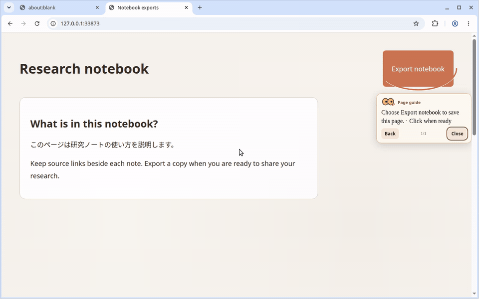
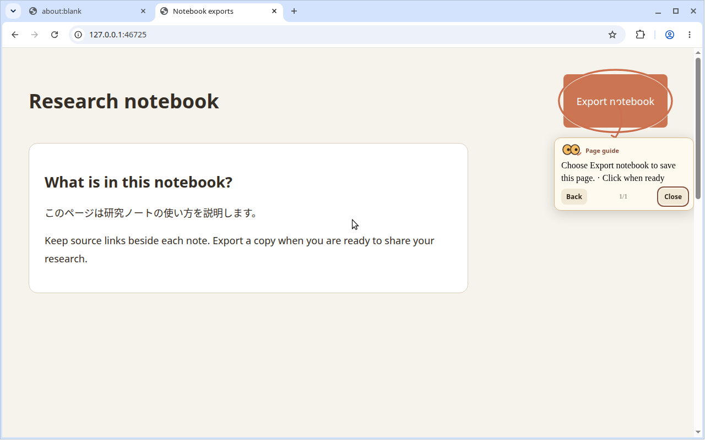
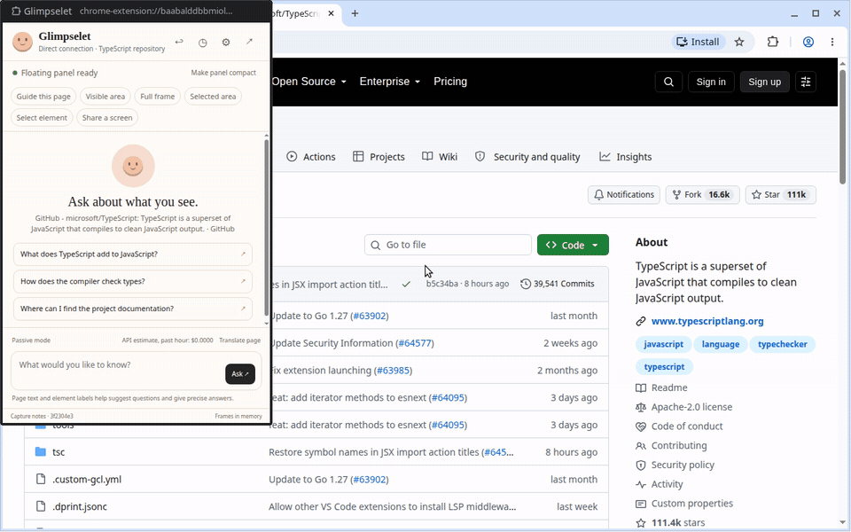
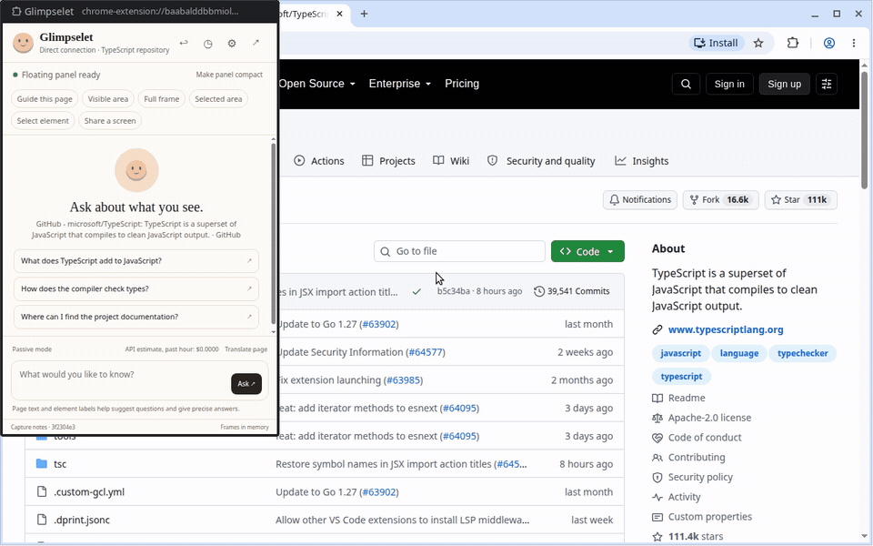

# Glimpselet

[English](README.md) · [繁體中文](README.zh-TW.md) · [简体中文](README.zh-CN.md) · [日本語](README.ja.md) · [한국어](README.ko.md) · [Español](README.es.md) · [Français](README.fr.md) · [Deutsch](README.de.md) · [Português](README.pt-BR.md)

一個懸浮聊天視窗，讓你向 Claude Code 詢問目前頁面或螢幕上的內容。閱讀與翻譯網頁、取得頁面控制項指引，也可以擷取區域後提問。

|           Glimpselet 懸浮聊天           |                 頁面指引範例                  |
| :-------------------------------------: | :-------------------------------------------: |
|  |  |

需求：較新的 Claude Code、使用你自己的訂閱帳號登入，以及桌面版 Chromium 瀏覽器，例如 Chrome 或 Edge。

Glimpselet 預設建立專用對話。你也可以選擇最近的 Claude Code 工作階段，在另一個程序中接續。若要將請求傳送到終端機中已開啟的互動工作階段，請啟用 channel 預覽功能。[Channel 設定](docs/DESIGN.md#the-running-claude-code-conversation)。

## 安裝

1. 在 Claude Code 中新增市集並安裝外掛：

   ```text
   /plugin marketplace add Arthur031221/Glimpselet
   /plugin install glimpselet@glimpselet
   ```

2. 在終端機確認 `claude plugin list` 顯示 Glimpselet **2.0.0**，再於 Claude Code 執行 `/glimpselet:glimpse`。

3. 依照歡迎指南連接瀏覽器。在本機桌面上，可選擇 **Try without installing**，也可以在自己的瀏覽器載入並配對擴充功能。如果 Claude Code 在遠端主機執行，請在有瀏覽器的電腦執行指南提供的 SSH 指令，並在該電腦下載 ZIP、於瀏覽器載入擴充功能。遠端主機無法使用免安裝瀏覽器。配對成功後，Glimpselet 面板會顯示連線模式與專案。

### 進階：從原始碼載入

從原始碼執行外掛需要 Node.js 22+ 與較新的 Claude Code。如果終端機已位於現有原始碼儲存庫的根目錄，請跳過前兩個指令。請在終端機執行以下指令：

```sh
git clone https://github.com/Arthur031221/Glimpselet.git
cd Glimpselet
npm ci
npm run build:plugin
claude plugin validate .
node -p "require('./.claude-plugin/plugin.json').version"
node -p "require('./dist-extension/manifest.json').version"
claude --plugin-dir "$PWD" plugin list
claude --plugin-dir "$PWD"
```

兩個版本檢查指令都應顯示 `2.0.0`。外掛清單應顯示 `glimpselet@inline` 的版本為 `2.0.0`，且已在此工作階段啟用。最後一個指令會開啟 Claude Code；在這個工作階段執行 `/glimpselet:glimpse`，即可開啟歡迎指南。`--plugin-dir` 只在目前工作階段載入這份原始碼中的外掛。每次啟動都要加上這個選項；重新執行 `npm run build:plugin` 建置後，請重新啟動 Claude Code。建置好的擴充功能位於 `dist-extension`，歡迎指南會將它複製到下方的固定資料夾。

在自己的桌面瀏覽器中，擴充功能會放在固定資料夾 `~/.glimpselet/extension`。在 Chrome 或 Edge 開啟 `chrome://extensions` 或 `edge://extensions`，開啟 **Developer mode**，選擇 **Load unpacked**，再選取該資料夾。開發者提示會持續顯示。新版本需要手動更新。

更新未封裝擴充功能時，先關閉舊浮動視窗，再執行 `/glimpselet:glimpse` 更新固定資料夾，然後在擴充功能頁面的卡片按「重新載入」。若 Claude Code 在遠端，請透過歡迎指南下載新版 ZIP，在瀏覽器所在電腦替換解壓縮後的檔案，再重新載入擴充功能。

## 已經安裝 Glimpselet？

請在執行 Claude Code 的電腦上，於終端機執行以下指令。只更新市集清單，不代表已安裝的外掛也已更新。

```sh
claude plugin marketplace update glimpselet
claude plugin update glimpselet@glimpselet
claude plugin list
```

在已開啟的 Claude Code 工作階段執行 `/reload-plugins`（或重新啟動 Claude Code），再執行 `/glimpselet:glimpse`。清單中的 `glimpselet@glimpselet` 應顯示 **2.0.0**，且指令應開啟歡迎與配對指南。也請在瀏覽器所在電腦的 `chrome://extensions` 或 `edge://extensions` 確認 Glimpselet 為 **2.0.0**。若外掛仍是 1.1.1，公開市集可能尚未提供 v2；舊的畫面選取頁不是 v2 歡迎指南。[更新驗證](docs/DESIGN.md#plugin-upgrades-and-release-verification)。

使用未封裝擴充功能時，指南會把新檔案複製到 `~/.glimpselet/extension`。請在 `chrome://extensions` 或 `edge://extensions` 重新載入 Glimpselet，確認版本為 **2.0.0**。透過 SSH 使用時，請在瀏覽器所在電腦從指南下載新版 ZIP，解壓縮到原先載入的資料夾，再重新載入。遠端主機無法在你的電腦開啟免安裝瀏覽器。

## 可以做什麼

- 使用 Opus、Sonnet 或 Haiku 取得串流回覆並繼續追問。
- 在全螢幕檢視中擷取分享的螢幕，或用頁面浮層裁切區域。按住 Shift 拖曳，再按 Enter 擷取或按 Esc 取消。
- 查看會隨頁面變化更新的建議問題。
- 可選擇開啟 Passive 摘要，用 Alt+P 暫停，並查看每小時費用。
- 在頁面實際控制項上顯示操作指引。可就地翻譯文字，並用 Restore 還原。
- 選取文字後可解釋、翻譯或提問。也能在內建閱讀器開啟 PDF 並提問。





| 快速鍵                                 | 操作                                                              |
| -------------------------------------- | ----------------------------------------------------------------- |
| Alt+Shift+G                            | 開啟 Glimpselet，選擇 **Float** 開啟懸浮聊天。                    |
| Ctrl+Shift+S（macOS 上為 Cmd+Shift+S） | 裁切目前頁面或分享的螢幕。                                        |
| Ctrl+Shift+7（macOS 上為 Cmd+Shift+7） | 從任何應用程式裁切。可在 `chrome://extensions/shortcuts` 中修改。 |
| 按住 Shift                             | 在 Glimpselet 懸浮視窗或頁面中開始裁切。                          |
| Alt+P                                  | 暫停 Passive 摘要。                                               |

在 macOS 上，Cmd+Shift+5 會開啟系統截圖工具。Shift 可在已授予 Glimpselet 存取權的網頁上使用。網頁無法監聽其他應用程式的按鍵。

第一個操作是 **Float**。使用需要頁面存取權的功能時，擴充功能會要求權限。使用你自己已登入的 Claude Code 工作階段時，不需要提供服務供應商 API 金鑰。直接 API 模式是選用功能，需要你自己的 API 金鑰。

## Claude Code 工作階段

Channel 預覽的指令與設定請參閱 [Claude Code 工作階段](docs/DESIGN.md#the-running-claude-code-conversation)。未啟用 channel 時，Glimpselet 可以在另一個程序中繼續所選工作階段。這是平行延續。請勿同時在終端機使用該工作階段，否則並行存取可能造成衝突。

## 限制與隱私

Glimpselet 支援桌面版 Chrome、Edge 和其他 Chromium 瀏覽器。商店發行前會顯示開發者提示，更新需要手動進行。瀏覽器設定、擴充功能商店和受限頁面等部分頁面會阻擋存取。Chrome 內建 PDF 檢視器無法讀取，請使用 Glimpselet 閱讀器。原生應用程式只提供像素畫面，無法讀取頁面文字或顯示疊加層。Shift 可在懸浮視窗及已授予存取權的網頁上使用。在其他應用程式中，請使用全域裁切快捷鍵。懸浮視窗不支援點擊穿透。

只有在你同意後，自動建議問題才會使用頁面內容。Passive 是選用功能：允許 Glimpselet 存取網站、開啟 **Passive**，再瀏覽或切換可檢查的頁面，即可取得摘要，不需要分享螢幕。頁面摘要使用已授權頁面的文字與結構。分享螢幕期間，畫面變化摘要需要已驗證的分享瀏覽器分頁，且該分頁與正在檢查的頁面一致。如果分享來源是視窗、整個螢幕、原生應用程式、未知來源或無法存取的來源，這類摘要會暫停。包含密碼欄位的頁面與封鎖清單中的網站不會產生自動摘要或建議問題。手動提問和擷取仍可使用。

[安裝指南](docs/INSTALL.md) | [使用方式](docs/USAGE.md) | [設計](docs/DESIGN.md) | [隱私詳情](docs/SECURITY.md)

Assisted by Claude/Codex.
